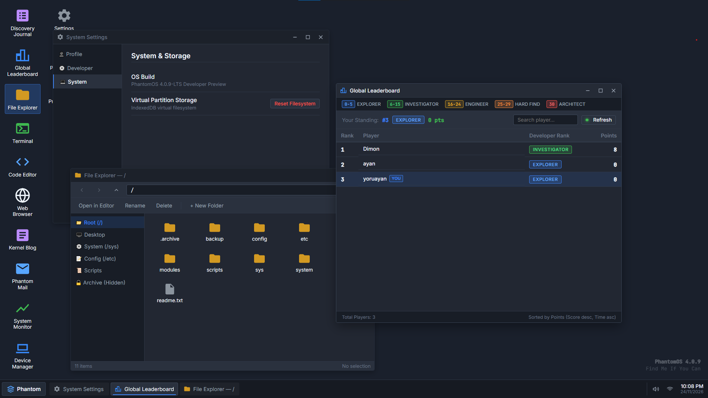
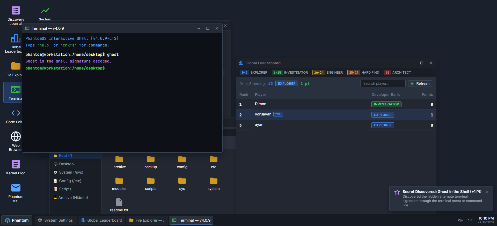

# Find Me If You Can

Find Me If You Can is a PhantomOS-based web OS where you, as a developer, have to find bugs and secrets to collect points.

Find the hidden gems. Each one gives you 1 point, and your rank depends on how many points you collect.

There are 50+ hidden gems. Hope you find them all!

## Screenshots

## Live Link

https://find-me-if-you-can-guys.web.app/

## A Message

Hey guys, I'm Ayan! I made this project and hope you like it.

If you have any crazy ideas to add to it, let me know on Instagram: [@yoru.ayan](https://instagram.com/yoru.ayan)

And yeah, I'm still finding a good way to make this harder for you :)